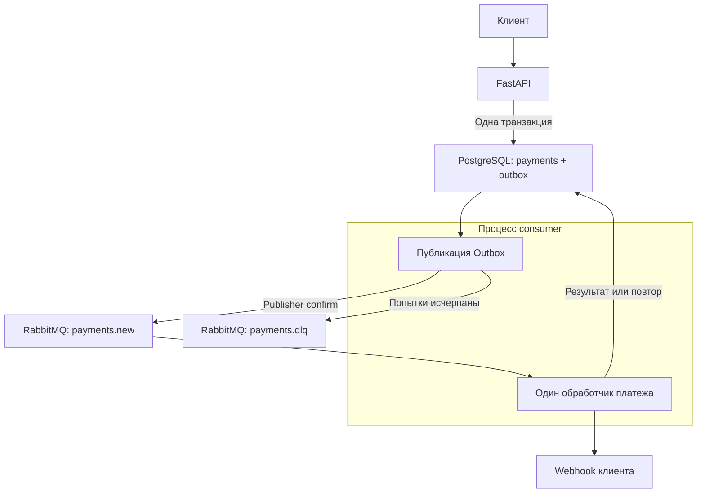

# Асинхронный сервис процессинга платежей

Сервис принимает платёж, сохраняет его в PostgreSQL и возвращает `202 Accepted`.
Обработка выполняется через RabbitMQ. После эмуляции платёжного шлюза consumer сохраняет результат и отправляет клиенту webhook.

Стек: Python 3.12, FastAPI, Pydantic v2, SQLAlchemy 2 в асинхронном режиме, asyncpg, PostgreSQL 17, RabbitMQ 4.2, FastStream 0.6, Alembic, Docker Compose v2.
Точные версии Python-зависимостей зафиксированы в `requirements.lock` и `requirements-dev.lock`.

## Быстрый запуск

Нужны Docker Engine / Docker Desktop и Docker Compose v2. Команды выполняются из корня проекта. Для Windows подходит Docker Desktop в режиме Linux containers.

```bash
cp .env.example .env
docker compose --profile demo up --build -d
docker compose ps -a
docker compose logs --tail=100 api consumer
```

В PowerShell первая команда: `Copy-Item .env.example .env`.
Для HTTP-примеров ниже в PowerShell используйте `curl.exe` вместо `curl`.

Профиль `demo` запускает локальный получатель webhook. Основные сервисы: `postgres`, `rabbitmq`, `api`, `consumer`. Сервис `migrate` применяет миграции один раз перед запуском приложения и завершается с кодом 0.

| Адрес | Назначение |
| --- | --- |
| `http://localhost:8000` | API |
| `http://localhost:8080` | Получатель webhook в профиле demo |
| `http://localhost:15672` | RabbitMQ Management |

Порты опубликованы только на `127.0.0.1`. PostgreSQL и AMQP доступны внутри сети Compose. Данные основной БД и брокера сохраняются в именованных томах.

В `.env.example` указаны демонстрационные реквизиты. API-ключ: `local-demo-api-key-change-me`. Доступ в RabbitMQ Management: `payments` / `rabbit-local-password`. Для окружения вне локальной проверки нужно заменить ключи и пароли. При замене пароля БД или брокера следует также обновить соответствующий URL подключения.

Проверка готовности:

```bash
curl -H "X-API-Key: local-demo-api-key-change-me" http://localhost:8000/health/ready
```

## API

На всех эндпоинтах основного приложения обязателен заголовок `X-API-Key`.
Отсутствующий или неверный ключ возвращает `401`.

### Создание платежа

```bash
curl -i -X POST http://localhost:8000/api/v1/payments -H "X-API-Key: local-demo-api-key-change-me" -H "Idempotency-Key: order-1001" -H "Content-Type: application/json" --data-binary @examples/create-payment.json
```

Тело запроса:

```json
{
  "amount": "1499.90",
  "currency": "RUB",
  "description": "Оплата заказа №1001",
  "metadata": {"order_id": "1001"},
  "webhook_url": "http://webhook:8080/webhook"
}
```

Пример ответа, `202 Accepted`:

```json
{
  "payment_id": "4939dff8-fb81-4e16-a439-b38d24216bd5",
  "status": "pending",
  "created_at": "2026-10-20T12:00:00Z"
}
```

В заголовке `Location` возвращается путь получения платежа.

- Сумма положительная, максимум 16 цифр до точки и 2 после. В JSON сумма
  сериализуется строкой, в Python используется `Decimal`, в БД - `NUMERIC(18, 2)`.
- Валюта: `RUB`, `USD` или `EUR`.
- Описание необязательное, до 1024 символов. Метаданные - JSON-объект до 16 KiB.
- `Idempotency-Key`: от 1 до 128 печатных ASCII-символов без пробелов.
- `webhook_url` обязателен. Его origin должен быть разрешён в конфигурации.
- Некорректные поля, лишние поля и отсутствующий ключ идемпотентности дают `422`.

Повтор с тем же ключом и тем же нормализованным телом возвращает тот же платёж с кодом `202` и его текущим статусом. Порядок ключей JSON и запись суммы `100` / `100.00` не влияют на сравнение. Другой запрос с тем же ключом даёт `409`.

### Получение платежа

Подставьте идентификатор из ответа создания:

```bash
curl -H "X-API-Key: local-demo-api-key-change-me" http://localhost:8000/api/v1/payments/PAYMENT_ID
```

Ответ содержит сумму, валюту, описание, метаданные, статус, ключ идемпотентности, webhook URL, даты создания и обработки. Дополнительные поля позволяют отличить результат оплаты от состояния доставки уведомления:

| Поле | Значение |
| --- | --- |
| `status` | `pending`, `succeeded` или `failed` |
| `failure_reason` | Причина отказа платежа, если есть |
| `attempts` | Количество зафиксированных попыток обработки, от 0 до 3 |
| `webhook_delivered_at` | Время успешной доставки webhook |
| `last_error` | Последняя техническая ошибка обработки или уведомления |
| `exhausted_at` | Время исчерпания попыток |

Неизвестный UUID возвращает `404`, некорректный UUID - `422`.
При недоступности БД API возвращает `503`.

### Служебные эндпоинты

| Эндпоинт | Назначение |
| --- | --- |
| `GET /health/live` | Процесс API отвечает |
| `GET /health/ready` | API имеет доступ к БД |
| `GET /openapi.json` | OpenAPI-схема с описанием авторизации |

Эти эндпоинты также требуют `X-API-Key`. Публичные `/docs` и `/redoc` отключены, чтобы не оставлять исключений из требования авторизации. Схему можно сохранить:

```bash
curl -H "X-API-Key: local-demo-api-key-change-me" http://localhost:8000/openapi.json -o openapi.json
```

Готовность API не зависит от RabbitMQ: во время недоступности брокера новые платежи сохраняются в БД и ожидают публикации из Outbox.

## Обработка и гарантии



### Идемпотентность создания

`payments.idempotency_key` имеет уникальное ограничение в БД. Используется
`INSERT ... ON CONFLICT DO NOTHING`, поэтому защита работает и при одновременных запросах. SHA-256 нормализованного тела позволяет обнаруживать конфликт данных. Запись платежа и первое событие Outbox коммитятся вместе.

### Outbox

Фоновая задача в процессе `consumer` выбирает готовую запись через
`FOR UPDATE SKIP LOCKED`. Для поиска используется частичный индекс
`(available_at, created_at) WHERE published_at IS NULL`.

Событие отправляется с `persist=True`, `mandatory=True` и включёнными publisher confirms. `on_return_raises=True` не позволяет считать успешной публикацию, для которой не нашлось маршрута. `published_at` устанавливается только после получения `Basic.Ack` от брокера.

Если процесс завершится после публикации, но до коммита `published_at`, событие может прийти повторно. Это ожидаемая семантика **at-least-once**.
Идентификаторы событий стабильны, consumer учитывает уже выполненные попытки. При ошибке публикации запись остаётся в Outbox; задержка увеличивается до 60 секунд. Количество попыток публикации Outbox не ограничено.

### Один consumer

Один обработчик FastStream выполняет весь сценарий:

1. Блокирует строку платежа и проверяет номер попытки.
2. Для `pending` эмулирует шлюз: `asyncio.sleep` на 2-5 секунд, примерно 90% успешных результатов и 10% отказов на новых платежах.
3. Сохраняет окончательный статус и `processed_at` отдельным коммитом.
4. Отправляет webhook, фиксирует доставку либо планирует повтор.
5. Подтверждает исходное сообщение только после завершения транзакций.

Результат эмулятора детерминирован по UUID платежа: повтор после сбоя не меняет исход уже инициированной операции. Реальный платёжный шлюз должен поддерживать идемпотентный запрос с идентификатором платежа и сверку неизвестного результата.

Статусы `succeeded` и `failed` окончательные. Бизнес-отказ шлюза не повторяется, но уведомление об этом отказе отправляется с обычной политикой retry.
Ошибка webhook не переводит успешный платёж в `failed`.

### Повторы и DLQ

Под «3 попытками» понимаются **первый запуск и два повтора**, всего три:

| Попытка | Задержка после предыдущей ошибки |
| --- | --- |
| 1 | Без задержки |
| 2 | 2 секунды |
| 3 | 4 секунды |

Задержки отсчитываются от фиксации ошибки. К ним добавляется интервал опроса Outbox и время ожидания в очереди. Значение основы задержки задаёт `RETRY_BASE_DELAY`.

Счётчик попыток и событие следующего запуска сохраняются одной транзакцией. Отложенное событие хранится в Outbox с `available_at`; обработчик не занимает consumer slot на время backoff. Дополнительные TTL-очереди и плагины RabbitMQ для этой реализации не нужны.

После третьей ошибки в той же транзакции сохраняются `exhausted_at` и событие для DLQ. Оно публикуется через Outbox в direct exchange `payments.dlx`, с routing key `payments.dead`, и попадает в `payments.dlq`.
Основной direct exchange - `payments`, routing key и очередь - `payments.new`. Обе очереди durable, типа quorum. Сообщения persistent.

Некорректные сообщения и ссылки на отсутствующий платёж сразу помещаются
в DLQ через Outbox: повтор не исправит их содержимое. Исходное тело в такой записи ограничено 4096 байтами и хранится в Base64 вместе с SHA-256.

Если БД недоступна, consumer не может безопасно зафиксировать попытку:
он делает NACK/requeue с короткой задержкой. Такие инфраструктурные redelivery не расходуют три прикладные попытки. Для основной quorum-очереди отключён автоматический delivery limit, чтобы продолжительный сбой БД не удалял сообщения.

При аварии до коммита фактический HTTP-вызов может повториться в рамках той же логической попытки. Ограничение «3» относится к зафиксированным попыткам, а не к доказуемому количеству внешних побочных эффектов при падении процесса.

## Webhook

Уведомление содержит `event_id`, `event_type=payment.completed`, `payment_id`, сумму, валюту, описание, метаданные, статус, причину отказа и даты. Все повторные доставки используют один `event_id` и одинаковое тело.

| Заголовок | Содержимое |
| --- | --- |
| `Content-Type` | `application/json` |
| `X-Webhook-Id` | Постоянный идентификатор уведомления |
| `Idempotency-Key` | Тот же идентификатор для дедупликации у получателя |
| `X-Webhook-Signature` | `sha256=` + HMAC-SHA256 исходных байтов тела |

Ключ HMAC - `WEBHOOK_SECRET`. Получатель проверяет подпись по исходным байтам до повторной сериализации JSON и хранит обработанные `event_id`.
API-ключ сервиса в webhook не передаётся. Успехом считается любой HTTP `2xx`. Другие статусы, ошибки соединения и таймауты приводят к повтору. Общий таймаут по умолчанию - 5 секунд, редиректы запрещены.

`WEBHOOK_ALLOWED_ORIGINS` содержит точные разрешённые origin:
схему, хост и порт. Например:

```dotenv
WEBHOOK_ALLOWED_ORIGINS=["https://merchant.example","http://webhook:8080"]
```

Путь и query в origin не указываются. Allowlist проверяется на входе API и перед отправкой. Разрешённые домены должны контролироваться оператором интеграции;
для промышленного окружения дополнительно нужны ограничения исходящего трафика. Произвольные клиентские адреса не включаются в allowlist автоматически.

Проверка полученных уведомлений в demo:

```bash
curl -H "X-API-Key: local-demo-api-key-change-me" http://localhost:8080/events
```

В файле `examples/create-payment.json` можно заменить путь webhook на `/flaky`
или `/fail` и отправить запрос с **новым** `Idempotency-Key`:

- `/webhook` отвечает успешно сразу;
- `/flaky` возвращает `503` два раза, затем `200`;
- `/fail` возвращает `503`, после трёх попыток уведомление окажется в DLQ.

Демо-получатель проверяет HMAC и хранит в памяти не более 100 событий.
Его состояние очищается при перезапуске. Это вспомогательный сервис проверки.

Просмотр состояния очередей без извлечения сообщений:

```bash
docker compose exec rabbitmq rabbitmqctl list_queues name messages_ready messages_unacknowledged
```

## Конфигурация

| Переменная | Назначение / значение по умолчанию |
| --- | --- |
| `DATABASE_URL` | SQLAlchemy URL с драйвером `postgresql+asyncpg` |
| `RABBITMQ_URL` | AMQP URL |
| `API_KEY` | Статический ключ, минимум 16 символов |
| `WEBHOOK_SECRET` | Ключ подписи, минимум 16 символов |
| `WEBHOOK_ALLOWED_ORIGINS` | Непустой JSON-массив разрешённых origin |
| `WEBHOOK_TIMEOUT` | Общий таймаут уведомления, 5 с |
| `GATEWAY_MIN_DELAY` / `GATEWAY_MAX_DELAY` | Эмуляция шлюза, 2 / 5 с |
| `RETRY_BASE_DELAY` | Основа backoff, 2 с |
| `OUTBOX_POLL_INTERVAL` | Опрос Outbox, 0.5 с |
| `OUTBOX_BATCH_SIZE` | Максимум публикаций за проход, 20 |
| `PUBLISH_TIMEOUT` | Ожидание подтверждения брокера, 5 с |
| `CONSUMER_PREFETCH` | Максимум неподтверждённых сообщений на канал, 10 |
| `DATABASE_POOL_SIZE` | Размер пула одного процесса, 15; overflow - ещё 5 |
| `LOG_LEVEL` | Уровень журналирования, `INFO` |

## Проверки

Полный набор на отдельных PostgreSQL и RabbitMQ:

```bash
docker compose -f compose.test.yaml up --build --abort-on-container-exit --exit-code-from tests
docker compose -f compose.test.yaml down
```

Тестовый Compose имеет отдельный проект, БД `payments_test` и временные хранилища. Он не использует данные основного Compose. Контейнер проверяет миграции (`alembic upgrade head`, `alembic check`), Ruff, mypy и pytest. Та же команда включена в GitHub Actions.

Быстрый прогон без инфраструктуры:

```bash
python -m venv .venv
source .venv/bin/activate
python -m pip install -r requirements-dev.lock
python -m pytest -q tests/unit
ruff check app tests migrations examples
ruff format --check app tests migrations examples
mypy app
```

В PowerShell замените строку активации на `.venv\Scripts\Activate.ps1`.

Интеграционные тесты требуют `TEST_DATABASE_URL` и `TEST_RABBITMQ_URL`. Без них соответствующие проверки пропускаются с явным сообщением. Тесты очищают только таблицы выделенной тестовой БД; имя БД обязано оканчиваться на `_test`. Миграции должны быть применены заранее.

Покрытые сценарии:

- конкурентные одинаковые и конфликтующие `Idempotency-Key`;
- откат платежа при ошибке сохранения Outbox;
- дубли сообщений и сохранение результата шлюза перед webhook;
- три попытки, экспоненциальная задержка и окончательная DLQ;
- публикация в реальный RabbitMQ и ошибочный маршрут;
- сбой после публикации до коммита и повтор с прежним event ID;
- `SKIP LOCKED`, валидация, API-ключи, подпись и таймаут webhook;
- некорректные сообщения и продолжение работы consumer.

Статус проверки при подготовке: 56 модульных тестов прошли; Ruff, mypy и генерация SQL миграции выполнены. Docker daemon в среде подготовки отсутствовал, поэтому
сборка образов и 13 интеграционных тестов на PostgreSQL/RabbitMQ здесь не выполнялись. Команда выше является обязательной финальной проверкой в окружении с Docker; её успешный результат заранее не заявляется.

## Структура

| Путь | Ответственность |
| --- | --- |
| `app/api.py` | HTTP-контракт, API-ключ, преобразование ошибок |
| `app/payments.py` | Создание и чтение платежа, идемпотентность |
| `app/models.py`, `app/db.py` | Схема и асинхронные сессии |
| `app/schemas.py` | Валидация запросов и сообщений |
| `app/events.py` | Стабильные event ID и запись Outbox |
| `app/broker.py` | Канал, очереди, обменники и bindings |
| `app/outbox.py` | Публикация с подтверждением и восстановлением после ошибки |
| `app/processor.py` | Обработка платежа и политика повторов |
| `app/worker.py` | Один подписчик FastStream, ACK/NACK, жизненный цикл |
| `app/gateway.py`, `app/webhook.py` | Эмулятор шлюза и HTTP-уведомления |
| `migrations/` | Версионированная миграция схемы |
| `tests/`, `examples/` | Автотесты и демонстрационная интеграция |

## Границы решения

Реализация сохраняет объём тестового задания: два основных процесса приложения, один обработчик очереди и две прикладные таблицы. Дополнительную таблицу версии создаёт Alembic.

- Сетевые обращения выполняются асинхронно. Во время одной операции со шлюзом или webhook удерживается блокировка строки платежа. Это упрощает защиту от конкурентных дублей, но занимает соединение БД до завершения ограниченного по времени вызова. Для больших нагрузок следующий шаг - lease-механизм и сверка с идемпотентным провайдером, с отдельными нагрузочными измерениями.
- Outbox удерживает транзакцию на время одной публикации, ограниченной таймаутом. `SKIP LOCKED` позволяет нескольким экземплярам не брать одну запись одновременно.
- Exactly-once между PostgreSQL, RabbitMQ и HTTP не заявляется. Получатель webhook обязан дедуплицировать события. Для реального шлюза нужна сверка неоднозначных результатов, а не слепой повтор списания.
- Quorum-очередь на одном узле Compose сохраняет данные, но не даёт отказоустойчивость к потере узла. Для неё нужен кластер RabbitMQ; для БД - отдельная стратегия HA.
- В тестовом сервисе один статический API-ключ и общий ключ подписи webhook. Мультитенантность, ротация ключей, rate limit и управление секретами не включены.
- Автоматическая очистка Outbox и повторный запуск DLQ не выполняются. В эксплуатации нужны политика хранения, мониторинг возраста Outbox/DLQ и управляемый redrive. Повторная публикация того же исчерпанного события не обнуляет счётчик попыток.
- Это эмулятор процессинга без реального списания денег. Нагрузочные характеристики и пригодность для промышленного платёжного контура не измерялись.

Остановить окружение с сохранением данных:

```bash
docker compose --profile demo down
```
